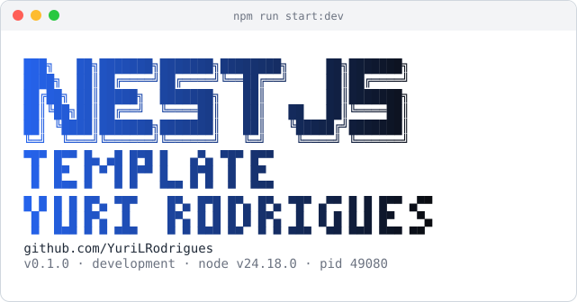
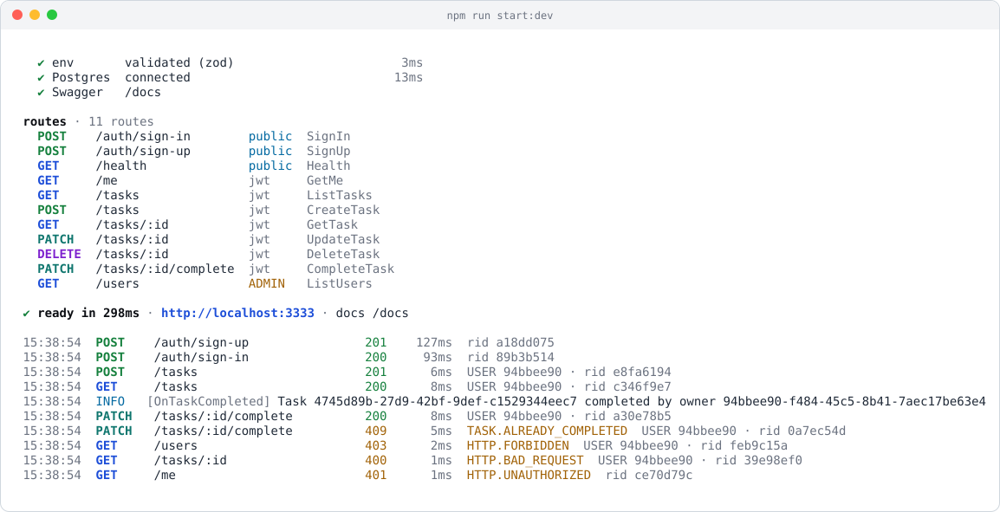
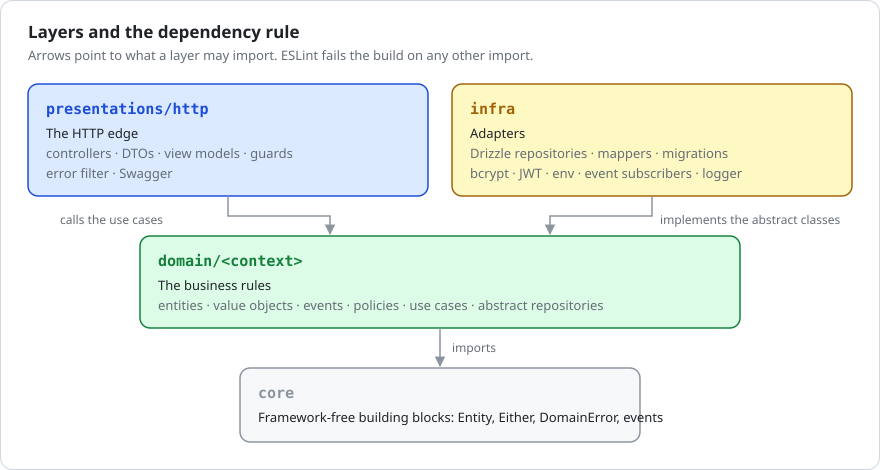
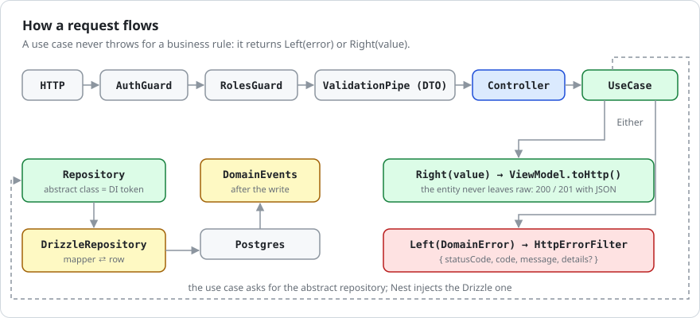

# nestjs-drizzle-clean-architecture

[](https://github.com/YuriLRodrigues/nestjs-drizzle-clean-architecture/actions/workflows/ci.yml)


> 🇺🇸 [Read in English](./README.en.md)

<p align="center">
  <picture>
    <source media="(prefers-color-scheme: dark)" srcset="./docs/assets/banner-dark.svg" />
    
  </picture>
</p>

Template de backend **NestJS + Drizzle ORM** com Clean Architecture e os blocos do DDD, lint que garante as camadas,
git hooks, testes e2e contra um Postgres de verdade e **skills do Claude Code** que conhecem os padrões.

Vem com dois contextos de exemplo que rodam de verdade: **identity** (cadastro, login com JWT, papéis) e **tasks**
(CRUD, busca paginada, regra de dono, um evento de domínio). Mantenha, adapte ou apague.

## O que vem pronto

- **Camadas**: `core` → `domain` → `infra` / `presentations`, com a regra de dependência **garantida pelo ESLint**: o
  domínio não importa Drizzle, o JWT do Nest nem a camada HTTP, e um use case não importa outro.
- **Use case devolve `Either`** e nunca lança exceção por regra de negócio. Todo erro tem um `code` estável
  (`TASK.NOT_FOUND`) e uma resposta só: `{ statusCode, code, message, details? }`.
- **Classe abstrata como token de DI**: o use case pede `TasksRepository`; a infra liga a implementação Drizzle e os
  testes usam a in-memory.
- **Entidades, value objects, agregados e eventos de domínio** sem framework dentro.
- **Auth**: guard JWT global (`@Public()` para liberar), `@Roles('ADMIN')`, `@CurrentActor()`.
- **Drizzle ORM 1.0** com migrations geradas e um migrator para produção.
- **Testes em três camadas**: unit (`*.unit.spec.ts`), integration com repositórios in-memory
  (`*.integration.spec.ts`) e e2e por HTTP contra Postgres, **sem precisar de Docker** (PGlite).
- **Qualidade**: ESLint (com tipos) + Prettier, husky (`pre-commit` roda o lint-staged e os testes relacionados,
  `commit-msg` roda o commitlint) e CI no GitHub Actions.
- **Terminal de verdade**: banner, checklist do boot, tabela de rotas com quem pode chamar cada uma, uma linha
  colorida por requisição e bloco de erro com a stack. Em produção, uma linha JSON por evento.
- **Swagger** em `/docs`, health check em `/health`, env validado com zod e Dockerfile multi-stage.
- **Pronto para o Claude Code**: `CLAUDE.md` e skills para criar módulo, use case e migration, e para revisar um diff
  contra os padrões.

## O terminal

<p align="center">
  <picture>
    <source media="(prefers-color-scheme: dark)" srcset="./docs/assets/terminal-dark.svg" />
    
  </picture>
</p>

O logger é do próprio template (`src/infra/logger`), sem dependência extra:

- **Banner** com o nome do projeto (`LOG_BRAND`). O degradê termina na cor oposta ao fundo do terminal: branco no tema
  escuro, preto no claro. O fundo é detectado sozinho.
- **Checklist do boot**: env validada, Postgres respondendo, Swagger no ar, com o tempo de cada etapa. Env inválida
  ou porta ocupada vira um bloco vermelho com a dica do que fazer.
- **Tabela de rotas** com o acesso de cada uma (`public`, `jwt` ou o papel exigido), lida dos mesmos decorators que
  os guards usam. Rota pública por engano aparece em todo boot.
- **Uma linha por requisição**: método, rota, status, tempo, quem chamou, o `code` do erro e o request id
  (`x-request-id`, devolvido no header).
- **Erro inesperado (5xx)** sai num bloco com a stack, com os arquivos do projeto em destaque.

| Variável         | Valores                                | Padrão                                |
| ---------------- | -------------------------------------- | ------------------------------------- |
| `LOG_FORMAT`     | `pretty` \| `json`                     | `json` em produção, `pretty` no resto |
| `LOG_LEVEL`      | `debug` \| `info` \| `warn` \| `error` | `info`                                |
| `LOG_BRAND`      | texto do banner                        | `NESTJS`                              |
| `LOG_BANNER`     | `on` \| `off`                          | `on`                                  |
| `LOG_REQUESTS`   | `on` \| `off`                          | `on`                                  |
| `LOG_BACKGROUND` | `auto` \| `dark` \| `light`            | `auto`                                |

`NO_COLOR` e `FORCE_COLOR` são respeitados, e sem terminal interativo (pipe, CI) não sai nenhuma cor. A assinatura do
banner fica em `src/infra/logger/terminal/banner.ts`: troque pela sua.

## Como rodar

Precisa de Node 24+ e de Docker (ou qualquer Postgres) para subir a API.

```bash
npm install
cp .env.example .env
docker compose up -d
npm run db:migrate
npm run start:dev
```

Abra <http://localhost:3333/docs>, chame `POST /auth/sign-up` e depois `POST /auth/sign-in`, e clique em **Authorize**
com o `accessToken`.

Os testes e2e **não** precisam de Docker: sem `DATABASE_URL`, eles sobem o PGlite (Postgres compilado para WASM) no
próprio processo.

## Scripts

| Script                                 | O que faz                                                         |
| -------------------------------------- | ----------------------------------------------------------------- |
| `npm run start:dev`                    | Sobe a API em modo watch                                          |
| `npm run build` / `npm run start:prod` | Compila em `dist/` / roda o compilado                             |
| `npm test`                             | Testes unit e integration                                         |
| `npm run test:e2e`                     | E2E por HTTP (usa `DATABASE_URL` se houver, senão PGlite)         |
| `npm run test:cov`                     | Unit e integration com cobertura                                  |
| `npm run lint` / `npm run lint:check`  | ESLint com / sem `--fix`                                          |
| `npm run typecheck`                    | `tsc --noEmit`                                                    |
| `npm run db:generate`                  | Gera a migration a partir do schema (nunca escreva uma à mão)     |
| `npm run db:migrate`                   | Aplica as migrations pendentes (drizzle-kit, desenvolvimento)     |
| `npm run db:migrate:prod`              | Aplica as pendentes com o migrator compilado (imagem de produção) |
| `npm run db:studio`                    | Abre o Drizzle Studio                                             |
| `npm run docs:assets`                  | Regenera as imagens deste README (precisa do `npm run build`)     |

## Estrutura de pastas

<p align="center">
  <picture>
    <source media="(prefers-color-scheme: dark)" srcset="./docs/assets/layers-dark.svg" />
    
  </picture>
</p>

```
src/
├── core/                    # blocos sem framework
│   ├── domain/              # Entity, AggregateRoot, ValueObject, UniqueEntityId
│   ├── events/              # DomainEvent, DomainEvents (barramento no processo)
│   ├── errors/              # DomainError (code + httpStatus)
│   ├── logic/               # Either, Optional
│   ├── auth/                # Actor, papéis
│   └── pagination/          # { results, meta }
├── domain/<contexto>/
│   ├── enterprise/          # entidades, value objects, eventos, policies
│   ├── applications/        # use cases + repositórios/gateways abstratos (tokens de DI)
│   └── errors/              # os DomainErrors do contexto
├── infra/
│   ├── env/                 # schema zod + EnvService
│   ├── database/            # schema do Drizzle, mappers, repositórios, migrator
│   ├── cryptography/        # bcrypt, JWT
│   └── events/              # subscribers dos eventos de domínio
├── presentations/http/
│   ├── controllers/<contexto>/  # um controller por endpoint, DTOs, view models, módulo
│   ├── auth/                # AuthGuard, RolesGuard, @Public, @Roles, @CurrentActor
│   └── errors/              # o filtro global de erros
test/
├── factories/               # makeUser(), makeTask()
├── repositories/            # repositórios in-memory
├── cryptography/            # fakes
└── e2e/                     # setup global (Postgres/PGlite) + specs HTTP
```

## O caminho de uma requisição

<p align="center">
  <picture>
    <source media="(prefers-color-scheme: dark)" srcset="./docs/assets/request-flow-dark.svg" />
    
  </picture>
</p>

## As regras que importam

1. Use case devolve `Either<DomainError, T>` e nunca lança por regra de negócio.
2. Controller tem três linhas úteis: chamar o use case, lançar no `isLeft()` e mapear o view model.
3. O repositório abstrato é o token de DI: classe abstrata no `domain`, `useClass` na `infra`, in-memory no teste.
4. Entidade nunca sai crua pelo HTTP: sempre um view model no meio.
5. Todo erro de negócio é um `DomainError` com `code` estável.
6. Um arquivo, uma responsabilidade: um use case, um controller por endpoint, uma tabela por arquivo de schema.
7. O teste nasce junto com o código, com repositório in-memory e factory `make*`, sem módulo do Nest.

Os detalhes, com exemplos, ficam em [`docs/architecture.md`](./docs/architecture.md) e
[`docs/patterns/`](./docs/patterns) (em inglês).

## API

| Método   | Rota                  | Auth    | Descrição                                                                   |
| -------- | --------------------- | ------- | --------------------------------------------------------------------------- |
| `POST`   | `/auth/sign-up`       | pública | Cria uma conta (`USER`)                                                     |
| `POST`   | `/auth/sign-in`       | pública | Devolve um access token                                                     |
| `GET`    | `/me`                 | bearer  | O usuário logado                                                            |
| `GET`    | `/users`              | `ADMIN` | Lista paginada de usuários                                                  |
| `POST`   | `/tasks`              | bearer  | Cria uma tarefa                                                             |
| `GET`    | `/tasks`              | bearer  | As suas tarefas (`ADMIN`: as de todos): `page`, `limit`, `search`, `status` |
| `GET`    | `/tasks/:id`          | bearer  | Uma tarefa                                                                  |
| `PATCH`  | `/tasks/:id`          | bearer  | Muda título/descrição (`description: null` apaga)                           |
| `PATCH`  | `/tasks/:id/complete` | bearer  | Conclui uma tarefa (dispara o `TaskCompletedEvent`)                         |
| `DELETE` | `/tasks/:id`          | bearer  | Apaga uma tarefa                                                            |
| `GET`    | `/health`             | pública | Liveness probe                                                              |

## Claude Code

O `CLAUDE.md` descreve a arquitetura e as convenções, e `.claude/skills/` traz as skills do projeto:

| Skill            | Para que serve                                                                       |
| ---------------- | ------------------------------------------------------------------------------------ |
| `new-module`     | Criar um contexto inteiro (entidade, repositório, use cases, Drizzle, HTTP e testes) |
| `new-use-case`   | Criar um use case com spec, controller, DTOs, view model e Swagger                   |
| `new-migration`  | Mudar o schema do Drizzle e gerar a migration                                        |
| `pattern-review` | Revisar um diff contra as regras acima                                               |

O `skills-lock.json` também fixa a skill da comunidade
[`nestjs-best-practices`](https://github.com/Kadajett/agent-nestjs-skills), de terceiros e sem cópia aqui. Para
instalar: `npx skills add Kadajett/agent-nestjs-skills`.

## Usando como template

1. Clique em **Use this template** no GitHub (ou clone) e troque o nome no `package.json`.
2. Mantenha o `identity` se precisar de contas. Apague o `tasks` (domínio, mappers, repositórios e schema da infra,
   controllers e testes) ou use-o de modelo para o seu primeiro contexto.
3. Mude o schema e rode `npm run db:generate` para criar a sua primeira migration.
4. Rode `/new-module` no Claude Code para cada contexto novo.

## Fora do escopo (bons próximos passos)

Refresh token, recuperação de senha, e-mail, upload, cache, filas e logger estruturado ficaram de fora de propósito,
porque cada projeto escolhe o seu provedor. Com as camadas, cada um vira um adapter na `infra` atrás de uma classe
abstrata no `domain`.

## Licença

[MIT](./LICENSE)
